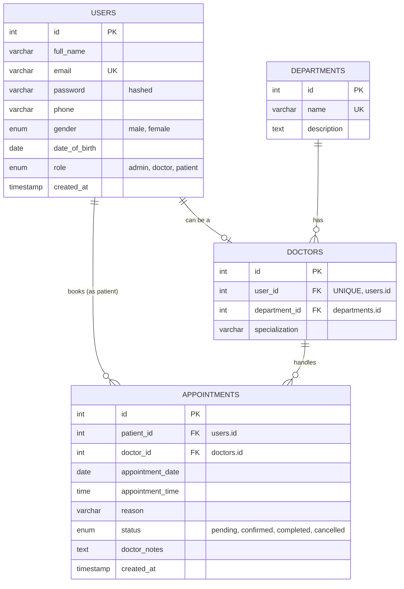

# 🏥 City Hospital – Hospital Management System

**Course:** CCS2305 Web Programming
**Built with:** HTML · CSS (Bootstrap 5) · PHP · MySQL

| Member | Name | Student ID | Part |
|--------|------|-----------|------|
| Member 1 | _(name)_ | _(id)_ | Database + shared layout + admin dashboard |
| Member 2 | _(name)_ | _(id)_ | Accounts & sessions (register, login, logout, profile) |
| Member 3 | _(name)_ | _(id)_ | Patient pages (book + my appointments) |
| Member 4 | _(name)_ | _(id)_ | Doctor page + departments |
| Member 5 | _(name)_ | _(id)_ | Admin: manage doctors + patients |

---

## 📑 Contents

1. [About the project](#1-about-the-project)
2. [Database design (ERD)](#2-database-design-erd)
3. [Course requirements checklist](#3-course-requirements-checklist)
4. [Setup – run it on your computer](#4-setup--run-it-on-your-computer)
5. [What is already done](#5-what-is-already-done)
6. [Who does what](#6-who-does-what)
7. [Member guides (step by step)](#7-member-guides-step-by-step)
8. [PHP cheat sheet (everyone reads this)](#8-php-cheat-sheet-everyone-reads-this)
9. [Git workflow for the team](#9-git-workflow-for-the-team)
10. [Troubleshooting](#10-troubleshooting)
11. [Next phase – Bonuses](#11-next-phase--bonuses)

---

## 1. About the project

### Introduction
**City Hospital** is a website where patients book appointments online, doctors manage their appointments, and admins manage the whole hospital. There are **three types of users** – Admin, Doctor, Patient – and each one has its own pages.

### Problem definition
Many clinics still book by **phone or paper**. That means long waits on the phone, **double bookings**, lost records, and patients who don't know if their appointment is confirmed.
Our website puts everything in one place and **blocks double bookings automatically**.

### What each user can do

| Patient | Doctor | Admin |
|---------|--------|-------|
| Register & log in | Log in (account made by admin) | Log in |
| Book an appointment | See appointments booked with them | See totals (patients, doctors…) |
| See their appointments + doctor notes | Confirm / complete / cancel | See & delete any appointment |
| Cancel an appointment | Write notes for the patient | Add / edit / delete departments |
| Edit their profile | Edit their profile | Add & delete doctors |
| | | Search & delete patients |

---

## 2. Database design (ERD)

> GitHub draws this diagram automatically. For the written documentation, take a screenshot of it.



**How to read it**

| Line | Meaning |
|------|---------|
| USERS – DOCTORS | One user can be **zero or one** doctor. Only users with role `doctor` have a row in `doctors`. |
| DEPARTMENTS – DOCTORS | One department has **many** doctors. |
| USERS – APPOINTMENTS | One patient books **many** appointments. |
| DOCTORS – APPOINTMENTS | One doctor has **many** appointments. |

**PK** = Primary Key (unique id) · **FK** = Foreign Key (points to another table's id) · **UK** = Unique

**Why it's designed this way**
- **One `users` table for everyone.** All three roles log in with email + password, so one table + a `role` column = one simple login page.
- **`doctors` only stores the extra doctor info** (department, specialization).
- When a user is deleted, their doctor row and appointments should be deleted too → `ON DELETE CASCADE`.
- When a department is deleted, its doctors stay but lose the department → `ON DELETE SET NULL`.

---

## 3. Course requirements checklist

| Requirement | Where | Who |
|-------------|-------|-----|
| HTML | All pages | ✅ Done |
| CSS (Bootstrap) | All pages + `css/style.css` | ✅ Done |
| PHP Validation | Every form | Members 2, 3, 4, 5 |
| PHP Sessions | Login, logout, page protection | Member 2 builds it, everyone uses it |
| Database | `database/hospital.sql`, `includes/db.php` | Member 1 builds it, everyone uses it |
| Insert / Select / Update / Delete | Spread across everyone (see section 6) | Everyone |
| Admin with own interface | `admin_*.php` | Members 1, 4, 5 |
| User: register, login, use a feature | Register, login, booking | Members 2 + 3 |
| Extra user type | Doctor | Member 4 |
| ERD in documentation | Section 2 | Member 1 |

---

## 4. Setup – run it on your computer

**1. Install** (once):
- **XAMPP** – <https://www.apachefriends.org> (gives you Apache to run PHP + MySQL for the database)
- **Git** – <https://git-scm.com/downloads>
- **VS Code** – <https://code.visualstudio.com>

**2. Clone the project into XAMPP's `htdocs` folder** (XAMPP only runs files in there):

```bash
cd C:/xampp/htdocs
```

```bash
git clone https://github.com/Oshii24/Hospital-Reservation-System.git hospital
```

**3. Start the server:** open the **XAMPP Control Panel** → click **Start** on **Apache** and **MySQL**.

**4. Open the site:** <http://localhost/hospital>

**5. Database** (after Member 1 has pushed `database/hospital.sql`):
open <http://localhost/phpmyadmin> → **Import** tab → choose `database/hospital.sql` → **Import**.
Re-import it whenever Member 1 changes it.

> ⚠️ Right now the pages are `.html`, so you can also just double-click them to preview. Once they become `.php`, you **must** open them through `http://localhost/hospital/...` – double-clicking a `.php` file will **not** work.

---

## 5. What is already done

✅ **All HTML + Bootstrap pages** are finished, with **sample data** so you can see how they look.

For now every page is plain **`.html`**. Forms show up but don't save anything yet – that's what the PHP is for.

**Before anyone adds PHP, Member 1 renames every page from `.html` to `.php`** (see [7.1 Step 3](#71-member-1--database--shared-layout--admin-dashboard)). PHP code only runs inside `.php` files. After that, everyone adds their PHP **inside the same file**. The guides below already use the final `.php` names.

Inside every page you'll find comments like this:

```html
<!-- PHP TODO (Member 3): repeat ONE <tr> for every appointment. These rows are samples. -->
```

That's your job marker. Search your files for `PHP TODO` to find all of them.

```
hospital/
├── index.html               Home page                    → Member 4 (departments list)
├── register.html            Patient sign-up              → Member 2
├── login.html               Login for all roles          → Member 2
├── profile.html             Edit my profile              → Member 2
├── book_appointment.html    Book an appointment          → Member 3
├── patient_dashboard.html   Patient's appointments       → Member 3
├── doctor_dashboard.html    Doctor's appointments        → Member 4
├── admin_departments.html   Manage departments           → Member 4
├── admin_dashboard.html     Totals + all appointments    → Member 1
├── admin_doctors.html       Manage doctors               → Member 5
├── admin_patients.html      Manage patients              → Member 5
└── css/style.css           Our extra styles             ✅ done

New files to create:
├── database/hospital.sql   → Member 1
├── includes/db.php         → Member 1
├── includes/header.php     → Member 1
├── includes/footer.php     → Member 1
├── includes/auth.php       → Member 2
└── logout.php              → Member 2
```

---

## 6. Who does what

Each member uses **at least three** of the database actions, so everyone can answer questions in the individual discussion.

| Member | Part | INSERT | SELECT | UPDATE | DELETE | Validation | Sessions |
|--------|------|:-:|:-:|:-:|:-:|:-:|:-:|
| **1** | Database + layout + admin dashboard | ✅ sample data | ✅ totals, all appointments | – | ✅ appointment | – (designs the tables) | uses role in navbar |
| **2** | Accounts & sessions | ✅ register | ✅ login | ✅ profile | – | ✅ register, login, profile | ✅ **builds it** |
| **3** | Patient pages | ✅ book | ✅ my appointments, doctor list | ✅ cancel | – | ✅ booking + double booking | uses `user_id` |
| **4** | Doctor + departments | ✅ add dept | ✅ doctor's list, depts, home | ✅ status/notes, edit dept | ✅ dept | ✅ status, dept name | uses doctor role |
| **5** | Admin doctors + patients | ✅ add doctor (2 tables) | ✅ doctors, patient search | – | ✅ doctor, patient | ✅ doctor form | uses admin role |

### Order of work (important!)

```
Step 1:  Member 1 → database + db.php + header/footer   → push → tell the team
         Member 2 → auth.php (sessions + helpers)        → push → tell the team
         Members 3, 4, 5 → read section 8, practise your SQL in phpMyAdmin's SQL tab
Step 2:  Everyone works on their own pages, in their own branch, at the same time
Step 3:  Test the full flow together (register → book → doctor confirms → admin sees it)
```

Members 1 and 2 go first because every page needs the database, the layout, and the session helpers.

---

## 7. Member guides (step by step)

Every private page starts with these lines (Member 2 creates `auth.php`):

```php
<?php
require_once 'includes/db.php';
require_once 'includes/auth.php';
require_login('patient');   // 'patient', 'doctor', 'admin', or empty = any logged-in user
```

---

### 7.1 Member 1 – Database + shared layout + admin dashboard

**Step 1 – `database/hospital.sql`**
1. Make a folder `database` and a file `hospital.sql` inside it. Start with:
   ```sql
   DROP DATABASE IF EXISTS hospital_db;
   CREATE DATABASE hospital_db;
   USE hospital_db;
   ```
2. Write `CREATE TABLE` for the 4 tables in the ERD (section 2).
   Order matters: `users` and `departments` **first**, then `doctors`, then `appointments` (a foreign key can't point to a table that doesn't exist yet).
3. Example foreign key line:
   ```sql
   FOREIGN KEY (user_id) REFERENCES users(id) ON DELETE CASCADE
   ```
4. Add **sample data**: 4 departments, 1 admin, 2 doctors (a `users` row **and** a `doctors` row each), 1 patient, 1–2 appointments.
5. Passwords must be **hashed**. Make a temporary file `hash.php`, open `localhost/hospital/hash.php`, copy the result, then **delete the file**:
   ```php
   <?php echo password_hash('password', PASSWORD_DEFAULT);
   ```
6. Import it in phpMyAdmin to test. Write the test logins in this README. Push.

**Step 2 – `includes/db.php`** – connects to the database. See [8.1](#81-connect-to-the-database). Every page will use `$conn`.

**Step 3 – Turn the pages into `.php`, then make `includes/header.php` and `includes/footer.php`**

First, rename every page from `.html` to `.php` (PHP only runs in `.php` files). In **Git Bash**, inside the project folder:
```bash
for f in *.html; do git mv "$f" "${f%.html}.php"; done
```
Then fix the links inside the pages: in VS Code press **Ctrl+Shift+H** (Replace in Files), search `.html`, replace with `.php`, files to include `*.php`, click **Replace All**. Check one page in the browser, then commit and push.

Now the shared layout:

1. `header.php` = everything from `<!DOCTYPE html>` down to `<main ...>` (copy it from any page). Add `require_once __DIR__ . '/auth.php';` at the top.
2. Make the **navbar change by role** with `$_SESSION['role']`. The 4 navbar versions (visitor, patient, doctor, admin) are already in the pages – copy their links.
3. Use `<title><?= $page_title ?> | City Hospital</title>` and call `show_flash();` right after `<main>`.
4. `footer.php` = from `</main>` to `</html>`.
5. In **every page**, replace the copied navbar/footer with:
   ```php
   <?php $page_title = 'Login'; require 'includes/header.php'; ?>
      ... page content ...
   <?php require 'includes/footer.php'; ?>
   ```
   Push this **before** the others start, so nobody gets merge conflicts.

**Step 4 – `admin_dashboard.php`**
1. `require_login('admin');`
2. The 4 numbers: `SELECT COUNT(*) AS c FROM users WHERE role = 'patient'`, and the same for `doctors`, `departments`, `appointments`.
3. All appointments: JOIN `appointments` → `users` (patient name) and → `doctors` → `users` again (doctor name). Give the same table two nicknames: `JOIN users p ...` and `JOIN users du ...`.
4. Delete button: `DELETE FROM appointments WHERE id = ?`.

✅ **Done when:** the database imports with no errors, every page shows the right navbar for the logged-in role, and the dashboard shows real numbers.

🎤 **Be ready to explain:** the ERD, primary/foreign keys, `ON DELETE CASCADE`, how `include` avoids repeating code.

---

### 7.2 Member 2 – Accounts & sessions

**Step 1 – `includes/auth.php`** (everyone needs this – push it early!)
Put in: `session_start()` and the helper functions `require_login($role)`, `set_flash($msg)`, `show_flash()`, `e($text)`. All of them are written out in [8.5](#85-sessions) and [8.7](#87-print-safely-with-e).

**Step 2 – `register.php`** (INSERT)
1. When the form is sent (`POST`), read every field from `$_POST`.
2. **Validate** ([8.4](#84-validation)): name ≥ 3 letters, valid email, phone digits only, gender is male/female, date of birth not in the future, password ≥ 6, both passwords match.
3. Check the email isn't already used (`SELECT`).
4. No errors → `password_hash()` → `INSERT` with role `'patient'` → flash "Account created" → redirect to `login.php`.
5. Errors → show them in the red box, and keep what the user typed (`value="<?= e($email) ?>"`).

**Step 3 – `login.php`** (SELECT + sessions)
1. Validate both fields are filled.
2. `SELECT id, full_name, password, role FROM users WHERE email = ?`
3. `password_verify($typed, $user['password'])` → if true, save `user_id`, `full_name`, `role` in `$_SESSION`.
4. Redirect by role: admin → `admin_dashboard.php`, doctor → `doctor_dashboard.php`, patient → `patient_dashboard.php`.
5. Wrong → show "Wrong email or password."

**Step 4 – `logout.php`** (new file, no HTML): `session_start()`, `session_destroy()`, redirect to `login.php`.

**Step 5 – `profile.php`** (SELECT + UPDATE)
1. `require_login();` (no role = anyone logged in).
2. `SELECT` the user's info and put it in the inputs' `value`.
3. On submit: validate name + phone → `UPDATE`. If "new password" isn't empty → hash it → `UPDATE` it too.
4. Update `$_SESSION['full_name']` so the navbar shows the new name.

✅ **Done when:** you can register, log in as each role, land on the right dashboard, edit your profile, and log out. Typing `admin_dashboard.php` while logged in as a patient sends you away.

🎤 **Be ready to explain:** what a session is, why passwords are hashed, server vs browser validation.

---

### 7.3 Member 3 – Patient pages

**`book_appointment.php`** (SELECT + INSERT)
1. `require_login('patient');`
2. Fill the doctor `<select>` with a `SELECT` that JOINs `doctors` → `users` (name) → `departments` (name). See [8.6](#86-join--combine-tables).
3. Add `min="<?= date('Y-m-d') ?>"` to the date input.
4. On submit, **validate**: doctor exists, date is today or later, time is in the list, reason 5–255 chars.
5. **Block double booking:** `SELECT` an appointment with the same doctor + date + time whose status isn't `'cancelled'`. Found → error.
6. `INSERT` the appointment with `patient_id = $_SESSION['user_id']` → flash → redirect to `patient_dashboard.php`.

**`patient_dashboard.php`** (SELECT + UPDATE)
1. `SELECT` the appointments `WHERE patient_id = ?` (your own `user_id`), JOIN to get the doctor's name and department.
2. One `<tr>` per row ([8.3](#83-show-rows-in-a-table)). Show the "no appointments" box when there are 0 rows.
3. Badge colours: pending = `bg-warning`, confirmed = `bg-primary`, completed = `bg-success`, cancelled = `bg-secondary`.
4. Show **Cancel** only for `pending` or `confirmed`.
5. Cancel: `UPDATE appointments SET status = 'cancelled' WHERE id = ? AND patient_id = ?`
   (the `AND patient_id` stops patients cancelling other people's appointments).

✅ **Done when:** a patient can book, can't double-book, sees their list, and can cancel.

🎤 **Be ready to explain:** JOIN, prepared statements, why `AND patient_id = ?` matters.

---

### 7.4 Member 4 – Doctor page + departments

**`doctor_dashboard.php`** (SELECT + UPDATE)
1. `require_login('doctor');`
2. ⚠️ `users.id` is **not** the same as `doctors.id`. First find the doctor's id: `SELECT id FROM doctors WHERE user_id = ?`
3. `SELECT` the appointments `WHERE doctor_id = ?`, JOIN `users` for the patient's info. One card per row.
4. Save button: validate the status is one of the 4 allowed values → `UPDATE appointments SET status = ?, doctor_notes = ? WHERE id = ? AND doctor_id = ?`.

**`admin_departments.php`** (all 4: INSERT, SELECT, UPDATE, DELETE)
1. `require_login('admin');`
2. **SELECT** all departments into the table.
3. Form sent with `id = 0` → **INSERT**. With `id > 0` → **UPDATE**.
4. Clicking **Edit** opens `admin_departments.php?edit=3` → read `$_GET['edit']`, `SELECT` that department, fill the form, put its id in the hidden input, change the title to "Edit department".
5. Validate: name ≥ 2 chars and not already used.
6. **DELETE** when `action = delete`.

**`index.php`** – replace the 4 sample department cards with a loop over `SELECT name, description FROM departments`.

✅ **Done when:** a doctor sees their appointments, changes status and writes notes (the patient sees them); departments can be added, edited, deleted, and show on the home page.

🎤 **Be ready to explain:** full CRUD on one page, `$_GET` vs `$_POST`.

---

### 7.5 Member 5 – Admin: manage doctors + patients

**`admin_doctors.php`** (INSERT into 2 tables + SELECT + DELETE)
1. `require_login('admin');`
2. Fill the department `<select>` from the database.
3. Validate all fields (same rules as register) + email not already used.
4. `INSERT` into `users` with role `'doctor'` → get the new id with `$conn->insert_id` → `INSERT` into `doctors` with that `user_id`.
5. List doctors: JOIN `doctors` → `users` → `departments`.
6. Delete: `DELETE FROM users WHERE id = ? AND role = 'doctor'` (the `doctors` row disappears by itself thanks to `ON DELETE CASCADE`).

**`admin_patients.php`** (SELECT with search + DELETE)
1. `require_login('admin');`
2. Read `$_GET['search']`. Use `WHERE role = 'patient' AND (full_name LIKE ? OR email LIKE ?)` with `'%' . $search . '%'`.
3. Show "No patients found." when there are 0 rows.
4. Delete: `DELETE FROM users WHERE id = ? AND role = 'patient'`.

✅ **Done when:** the admin adds a doctor who can then log in, deletes doctors, and searches & deletes patients.

🎤 **Be ready to explain:** `insert_id`, inserting into two linked tables, `LIKE` search.

---

## 8. PHP cheat sheet (everyone reads this)

### 8.1 Connect to the database
```php
<?php
$conn = new mysqli('localhost', 'root', '', 'hospital_db');   // XAMPP: user root, no password
if ($conn->connect_error) {
    die('Connection failed: ' . $conn->connect_error);
}
$conn->set_charset('utf8mb4');
```

### 8.2 Run a query safely (prepared statements)
❌ Never put user input straight into SQL (*SQL injection*):
```php
$conn->query("SELECT * FROM users WHERE email = '$email'");
```
✅ Always use `?` placeholders:
```php
$stmt = $conn->prepare('SELECT id, full_name FROM users WHERE email = ?');
$stmt->bind_param('s', $email);      // one letter per ?   s = string, i = integer
$stmt->execute();
$result = $stmt->get_result();       // only for SELECT
$user = $result->fetch_assoc();      // one row as an array, or null
```
INSERT / UPDATE / DELETE are the same, just without `get_result()`.

### 8.3 Show rows in a table
```php
<?php while ($row = $result->fetch_assoc()): ?>
    <tr>
        <td><?= e($row['full_name']) ?></td>
        <td><?= e($row['email']) ?></td>
    </tr>
<?php endwhile; ?>
```
`<?= ... ?>` is short for `<?php echo ...; ?>`. Check `$result->num_rows === 0` for "nothing found".

### 8.4 Validation
```php
$errors = [];
if ($_SERVER['REQUEST_METHOD'] === 'POST') {
    $email = trim($_POST['email'] ?? '');

    if (!filter_var($email, FILTER_VALIDATE_EMAIL)) $errors[] = 'Invalid email.';
    if (strlen($password) < 6)                     $errors[] = 'Password too short.';
    if (!preg_match('/^[0-9]{8,15}$/', $phone))    $errors[] = 'Phone: digits only.';
    if ($date < date('Y-m-d'))                     $errors[] = 'Date is in the past.';

    if (empty($errors)) {
        // safe to save to the database
    }
}
```
The HTML already checks in the browser (`required`, `minlength`, `pattern`), but **PHP must check again** because anyone can bypass the browser.

### 8.5 Sessions
```php
session_start();                          // top of every page (it's in auth.php)
$_SESSION['user_id'] = $user['id'];       // save (at login)
$id = $_SESSION['user_id'];               // read (on any page)
session_destroy();                        // forget everything (at logout)
```
Protect a page:
```php
function require_login($role = null) {
    if (!isset($_SESSION['user_id'])) { header('Location: login.php'); exit; }
    if ($role && $_SESSION['role'] !== $role) { header('Location: index.php'); exit; }
}
```
Flash message (shows once on the next page):
```php
function set_flash($msg) { $_SESSION['flash'] = $msg; }
function show_flash() {
    if (isset($_SESSION['flash'])) {
        echo '<div class="alert alert-success">' . e($_SESSION['flash']) . '</div>';
        unset($_SESSION['flash']);
    }
}
```

### 8.6 JOIN – combine tables
```sql
SELECT a.appointment_date, u.full_name AS doctor_name
FROM appointments a
JOIN doctors d ON a.doctor_id = d.id     -- appointment -> doctor
JOIN users u   ON d.user_id   = u.id     -- doctor -> their name
WHERE a.patient_id = ?
```
Tip: write and test your SQL in **phpMyAdmin → SQL tab** first, then put it in PHP.

### 8.7 Print safely with `e()`
```php
function e($text) { return htmlspecialchars((string) $text, ENT_QUOTES, 'UTF-8'); }
```
Always print user data as `<?= e($row['name']) ?>` so nobody can inject `<script>` (*XSS*).

### 8.8 Passwords
```php
$hash = password_hash($password, PASSWORD_DEFAULT);   // register: store $hash
password_verify($typed, $user['password']);           // login: true or false
```

### 8.9 Redirect after saving
```php
set_flash('Saved!');
header('Location: patient_dashboard.php');
exit;
```
This stops the form being sent twice when someone presses F5. Do all PHP logic **above** `require 'includes/header.php'`, because a redirect fails once HTML has been printed.

---

## 9. Git workflow for the team

**Rules:** never work on `main` directly · pull before you start · only edit **your own files**.

**1. Get the latest code**
```bash
git checkout main
```
```bash
git pull
```
**2. Make your own branch** (once per feature)
```bash
git checkout -b member3-booking
```
**3. Save your work**
```bash
git add .
```
```bash
git commit -m "Add booking validation and insert"
```
**4. Upload it**
```bash
git push -u origin member3-booking
```
**5. On GitHub:** click **Compare & pull request** → **Create pull request** → a teammate checks it → **Merge**.

**6. Back to main and update**
```bash
git checkout main
```
```bash
git pull
```

**Merge conflict?** Git marks the file with `<<<<<<<`, `=======`, `>>>>>>>`. Keep the right lines, delete the markers, then `git add .` and `git commit`. VS Code shows *Accept Current / Incoming / Both* buttons to help.

---

## 10. Troubleshooting

| Problem | Fix |
|---------|-----|
| Browser shows code instead of the page | Open through `http://localhost/hospital/...` |
| `Not Found` | The folder isn't in `C:\xampp\htdocs`, or has another name |
| `Connection failed` | Start MySQL in XAMPP |
| `Unknown database 'hospital_db'` | Import `database/hospital.sql` |
| Apache won't start | Port 80 is busy: XAMPP → Apache **Config** → `httpd.conf` → change `Listen 80` to `Listen 8080`, use `localhost:8080/hospital` |
| `Cannot modify header information` | You printed HTML before `header('Location: ...')`. Move the PHP logic above the HTML |
| Blank white page | Add `ini_set('display_errors', 1); error_reporting(E_ALL);` at the top to see the error |
| No styling | Bootstrap loads from the internet – check your connection |

---

## 11. Next phase – Bonuses

Up to **+5 marks**. Starts once the PHP is working. One bonus per person, kept simple:

| Bonus | Idea | Who |
|-------|------|-----|
| Dark / Light mode | Toggle button in the navbar using Bootstrap's `data-bs-theme` | Member 1 |
| Cookies | "Remember my email" checkbox on login; remember the dark/light choice | Member 2 |
| JavaScript | "Are you sure?" before Cancel/Delete; live "passwords match" check | Member 3 |
| jQuery | Live search on the patients/doctors tables without reloading | Member 4 |
| Arabic + English | Language switch button; Arabic uses `dir="rtl"` | Member 5 |
| Angular / React / Node.js | Skipped – too big for this project | – |
